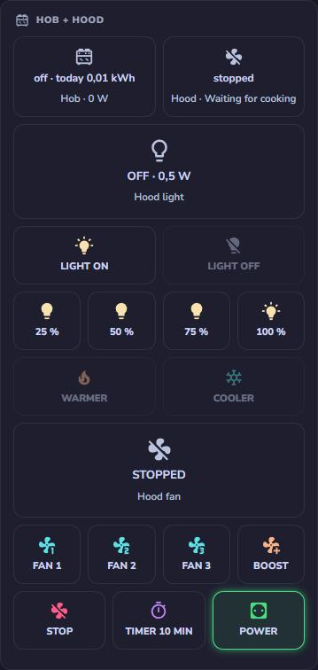
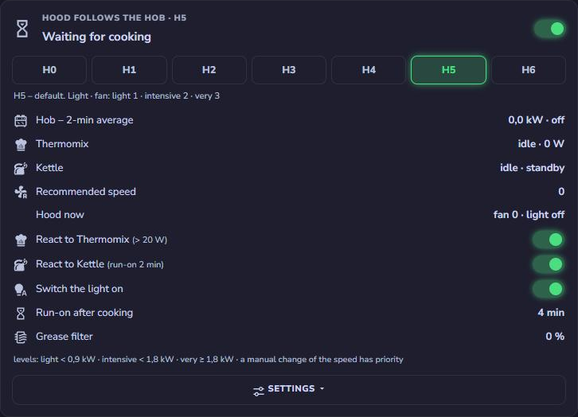
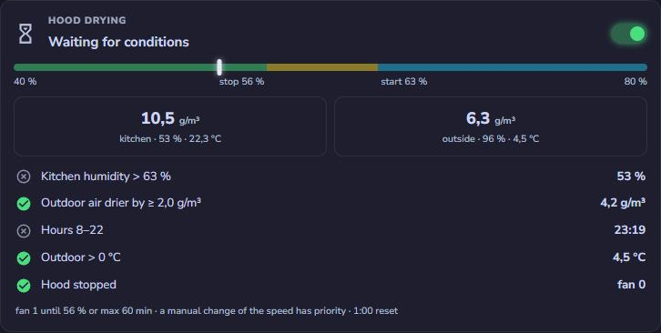

# HbH – Hob bridge Hood

**English** · [Polski](README.pl.md)

[](https://github.com/jotuera/hbh-hob-bridge-hood/actions/workflows/ci.yml)

[](https://esphome.io)
[](https://docs.m5stack.com/en/core/ATOM%20Lite)
[](LICENSE)
[](https://buymeacoffee.com/jotuera)

**Your induction hob drives your cooker hood – via ESPHome, for hoods with a simple 433 MHz remote.** The hood in
Home Assistant, and a hood that follows the induction hob by itself. One ESP32 sends the remote's codes and runs the
hood's brain: it knows the fan speed, light and brightness from the hood's power reading, switches the light on when the hob is switched on, sets the fan from the hob's power,
runs on after cooking, dries the kitchen with the hood and sets a cool light in the morning and a warm one in the
evening. Local, no cloud, no YAML automations – all settings are entities of the device.

> Built and tested on a **Ciarko Duo 74** with an **AEG IKK86688IB** induction hob. Other Ciarko hoods with the same
> remote family (e.g. SU Mini with the XY8011-RF remote) share the key codes – learn your remote's ID with the
> receiver and `tools/learn_codes.py`.
>
> **Status: beta.** Runs in the author's kitchen: the transmitter, the hood state, speed / light / brightness /
> colour, the cards, the hob automation and the calibration are tested on the hood. The hob automation, drying and
> night reset were ported to the ESP from Home Assistant automations used since October 2026 – the ESP versions run
> since November 2026. One profile so far (Ciarko XY8011-RF).

| Part | What it does | You get in Home Assistant |
|---|---|---|
| **Hood ESP** – Atom Lite + Unit RF433T (`hbh.yaml`) | sends the remote's frames at exactly 433.92 MHz with the toggle bit like the real remote, and runs the brain | fan speed, light (off / 25–100 %), colour, timer; hood state; hob → hood automation; drying; settings |
| **Receiver** (optional) – Atom Lite + Unit RF433R (`hbh-remote-rx.yaml`) | decodes the original remote, measures how long a key is held | the brain and the cards know when someone used the remote; event `esphome.hbh_remote` |
| **Shelly Plus 1PM** in the hood's supply | power reading and a hard off | the hood state (speed, light, brightness) is computed from it |
| **Shelly Pro 3EM** / Pro EM-50 / EM Gen3 on the hob (optional) | hob power, 1–3 phases | hob switched on, cooking, 2-min average, alarm |
| **Cards** (`cards/hbh-cards.js`) | three Lovelace cards, no other custom cards needed | control, hob automation with profiles H0–H6, drying |

<table>
<tr>
<td rowspan="2" valign="top"></td>
<td valign="top"></td>
</tr>
<tr>
<td valign="top"></td>
</tr>
</table>

<sub>The three cards in the author's kitchen: control (hob tile with today's energy, hood state from the power reading), hob → hood automation with profiles H0–H6, drying by absolute humidity.</sub>

## Hood profiles

Everything that depends on the hood lives in one file in `esphome/profiles/`: the RF frame (bit timing, frame length,
toggle bit), the codes of the remote's keys and the hood's power table. Include one profile in the packages of both
devices.

| Profile | Hoods | Status |
|---|---|---|
| `ciarko_xy8011.yaml` | Ciarko with the XY8011-RF remote family – Duo 74 (tested), SU Mini (same key codes) | tested |

**Another hood?** If its remote sends plain OOK frames (most hood remotes do; rolling codes cannot work), copy a
profile, learn your keys with the receiver and `tools/learn_codes.py`, and measure the power table. Open an issue
*New hood profile* with the file – every profile makes HbH work for more kitchens. Remotes with other key layouts
(direct speed keys, separate light on/off), IR remotes and other frequencies (CC1101) are on the roadmap.

## Which Shelly to use

**Hood** – a Shelly with power metering in the hood's supply. The hood state is computed from it, so it has to read
small powers well (standby 0.5 W, light steps of ~3 W): **Shelly 1PM Gen3**, **Shelly 1PM Mini Gen3** or **Shelly Plus
1PM** (tested). A Shelly Plus Plug S works too when the hood is plugged into a socket.

**Hob** – a DIN-rail energy meter with current clamps in the hob's circuit. A hob draws up to 7.4 kW (32 A on one
phase), far beyond a plug or a 1PM (16 A) – do **not** put the hob through a relay.

| Hob connection | Meter | Sources in the device |
|---|---|---|
| 3 phases (most hobs in PL/DE/CZ) | **Shelly Pro 3EM** (tested) or Shelly 3EM Gen3 | hob power = total active power; hob ON = total apparent power (VA) |
| 2 phases (2 × 16 A) | **Shelly Pro EM-50** (2 channels, 50 A clamps) – one channel per phase | `sensor.channel_1_power+sensor.channel_2_power`, the same for the apparent power |
| 1 phase (32 A) | **Shelly EM Gen3** or **Shelly Pro EM-50** (one channel) | channel power; channel apparent power (or current in A) |

**Hob on 1, 2 or 3 phases.** The brain works with the total power, so the number of phases does not matter: give one
total entity, or the phases summed with `+` (`sensor.l1_power+sensor.l2_power+sensor.l3_power`). The same works for
the apparent power. **Hob ON threshold:** a hob switched ON without heating powers its electronics – the author's
3-phase AEG then shows ≈ 380 VA instead of ≈ 23 VA; the default threshold is 150 VA. A 1-phase hob shows less: switch
it ON, look at the apparent power (or the current) and set the threshold to about half of it. Without an apparent-power
source the light follows cooking only (not the ON button).

## Why not Broadlink?

The first version used a Broadlink RM4 Pro. It "worked" – every second or third time. An RTL-SDR showed why: the
remote transmits at **~433.93 MHz**, the Broadlink at **~433.795 MHz**, at the edge of the hood receiver's band. The
RF433T has a fixed 433.92 MHz crystal: **28 of 28** codes arrived, from the basement and from another floor. A second
reason for "press twice": the remote flips a **toggle bit** on every press, and the hood ignores a press with the same
toggle bit as the previous one (it takes it as the same key still held). The transmitter here flips it like the remote.

## Hardware

| Part | Notes |
|---|---|
| M5Stack **Atom Lite** (ESP32-PICO) + **Unit RF433T** | Grove cable – data on **G26** |
| M5Stack **Atom Lite** + **Unit RF433R** (optional) | Grove cable – data on **G32** (the other Grove wire!) |
| **Shelly Plus 1PM** | in the hood's supply; its power reading is the hood's state sensor |
| **Shelly Pro 3EM** / Pro EM-50 / EM Gen3 | on the hob's circuit (optional – only for the hob automation), see [Which Shelly to use](#which-shelly-to-use) |

No soldering. Put the transmitter within a few metres of the hood – not inside a metal cabinet.

## Installation

### 1. ESPHome

> **Order:** first the receiver (with the example codes), learn your remote's codes (step 1b), then
> both devices with your codes.

Copy the `esphome/` folder of this repo to your ESPHome folder as `hbh/`, add the keys of
`secrets.yaml.example` to your `secrets.yaml` and create the device file:

```yaml
# hbh-hood.yaml in your ESPHome folder
substitutions:
  name: hbh-hood
  friendly_name: HbH Hood
  # optional defaults of the sources – they can be set later in the card editor
  src_hood_power: sensor.hood_power
  src_hood_switch: switch.hood
  # the codes of YOUR remote (step 1b) – the profile only has examples
  # key_light: "…"
  # key_fan_minus: "…"   …

packages:
  profile: !include hbh/profiles/ciarko_xy8011.yaml   # your hood
  lang: !include hbh/lang/hbh_en.yaml     # entity names: hbh_en / cs / de / es / fr / hu / it / nl / pl / pt / sk
  hood: !include hbh/hbh.yaml

wifi:
  manual_ip:              # recommended when HA is in another VLAN – mDNS does not cross VLANs
    static_ip: 192.168.1.78
    gateway: 192.168.1.1
    subnet: 255.255.255.0
```

The receiver:

```yaml
# hbh-remote-rx.yaml in your ESPHome folder
substitutions:
  name: hbh-remote-rx
  friendly_name: HbH Remote RX
  # the same key_* lines as in hbh-hood.yaml

packages:
  profile: !include hbh/profiles/ciarko_xy8011.yaml
  lang: !include hbh/lang/remote_rx_en.yaml
  rx: !include hbh/hbh-remote-rx.yaml
```

Build them with the ESPHome dashboard (Home Assistant add-on) or the `esphome` CLI. The first install goes over USB
(dashboard → *Install* → *Manual download*, then flash the file with [web.esphome.io](https://web.esphome.io)), later
installs go over Wi-Fi.


### 1b. Your remote's codes

The codes in `esphome/profiles/ciarko_xy8011.yaml` are **examples** (placeholder remote ID) – the hood will not react to them. Each remote has its own 16-bit ID and a check
byte that depends on it, so the codes cannot be computed – they have to be learned:

```bash
esphome logs hbh-remote-rx.yaml | python3 tools/learn_codes.py -o my_remote.yaml
# press: light, fan −, fan +, timer, key 4 (brighter), key 5 (dimmer) – then Ctrl+C
```

The receiver logs frames of an unknown remote as `unknown frame: <bits>`; the tool groups them into keys, ignores
the toggle bit and writes the `key_*` lines. Paste them into the `substitutions:` of **both** device files (hood
and receiver) – they override the example codes of the profile – and install both devices again. Until then the
hood does not react to the ESP and the receiver reports every key as `unknown frame`.

### 2. Home Assistant

1. Add the devices in *Settings → Devices & services → ESPHome* (by IP if they are in another VLAN).
2. On **both** devices: *Configure* → enable **Allow the device to perform Home Assistant actions**. The hood ESP
   needs it to switch the hood relay and send the hob alarm; the receiver to send the remote events.

### 3. Cards

Copy `cards/hbh-cards.js` to `/config/www/` and add it in *Settings → Dashboards → ⋮ → Resources* as
`/local/hbh-cards.js` (JavaScript module). Then add the cards:

```yaml
type: custom:hbh-card                # control
```

```yaml
type: custom:hbh-automation-card     # hood follows the hob
aux1_name: Thermomix                 # optional names of the extra sources
aux2_name: Kettle
```

```yaml
type: custom:hbh-drying-card         # drying with the hood
```

The cards find the device and its entities by themselves (by their original names in every language), so no entity
ids are needed. `device:` pins a device when there are more.

### 4. Sources

Open the editor of any card and choose the Home Assistant entities that feed the brain, then press **Apply sources
(restart the device)**. The sources are stored in the ESP, not in the card. A source can also be an attribute:
`climate.kitchen:current_temperature`.

| Source | Needed for |
|---|---|
| Hood power (W) | **required** – the hood state |
| Hood relay (switch) | power on from the card, pairing after a power cut, night reset |
| Hob power (W) | cooking, fan from the hob's power – one total entity or phases with `+` |
| Hob apparent power (VA) or current (A) | light when the hob is only switched ON – threshold *Hob ON threshold* |
| Source 1, Source 2 | extra cooking sources, e.g. Thermomix power (W) or a kettle (W or a `heating` state) |
| Remote receiver – Remote event | knowing that someone used the original remote (manual takeover, card hints) |
| Kitchen humidity / temperature, outdoor temperature / humidity | drying |

### 5. Pairing after a power cut

After power-up the hood pairs for 60 s with the first remote it hears. With the hood relay as a source, the ESP sends
a *fan −* 5 s after the relay switches the hood on. Otherwise switch the hood off and on and press any key on the card
within a minute.

## How the hood state works

The hood reports nothing, so the state is computed from the hood's supply power. The power **adds up**:

| | Net power |
|---|---|
| standby | 0.5 W |
| fan 1 / 2 / 3 | 4.4 / 10.0 / 27.5 W |
| boost (4) | 100–170 W |
| light 25 / 50 / 75 / 100 % | 3.2 / 6.3 / 8.9 / 11.9 W (the colour has almost no effect) |

**Calibration.** The table comes from the hood profile; press **Calibrate hood** (device configuration or the settings
of the automation card) and the ESP measures your hood by itself: it switches through standby, fan 1–3, boost and the
four light levels, waits for a stable power at every step and keeps the median (~4 min, kitchen free – switching the
hob on aborts it). The measured table overrides the profile, survives restarts and is printed in the log as `pw_*`
lines for a new profile; *Restore profile power table* goes back. A warning means two states draw almost the same
power and may be confused.

Values overlap (light 100 % ≈ fan 1 + light 50 %), so the brain tracks **transitions**: from the last state it picks
the cheapest change that explains the new power; the last command (own transmitter or the original remote) is a soft
hint. Motor start spikes are ignored, a resync every minute fixes a wrong state, and when the light is switched on the
brightness is taken from the power (the hood restores its last brightness). At speed 3 and boost the light cannot be
measured – there it follows the commands. Every change from the card is checked against the power and corrected if a
press was lost (*Hood not responding* when it still fails).

## Hob → hood

| | Default |
|---|---|
| hob switched **ON** (apparent power above *Hob ON threshold*) | light on (at its last brightness) |
| cooking (> 60 W, or 2-min average > 30 W) | fan from the profile table |
| power levels | light < 900 W ≤ intensive < 1800 W ≤ very intensive (20 % hysteresis down) |
| run-on | fan 1 for 4 min, then off and the light off if the automation switched it on (2 min after source 2 only) |
| hob switched off without cooking | light off after 2 min (if the automation switched it on) |
| manual change during cooking (card, remote, or a speed differing from the plan) | the automation leaves the fan alone until the session ends |
| colour | cool from 06:00, warm from 17:00 (when the light is switched on and at these times) |
| hob alarm | heating > 120 min, or nobody home (`zone.home` = 0) while heating |

Profiles – **H** for *hob*: the higher the profile, the harder the hood works for the hob. Fan speed for light /
intensive / very intensive cooking:

| H0 | H1 | H2 | H3 | H4 | H5 (default) | H6 |
|---|---|---|---|---|---|---|
| off | light only | 1 1 1 | 0 1 1 | 1 1 2 | 1 2 3 | 2 3 3 |

An AEG / Electrolux hob with Hob²Hood? HbH works in a similar spirit but independently – from the hob's power
measured by a Shelly, with any hob and any hood that has a supported remote. HbH is not affiliated with Electrolux;
Hob²Hood is a trademark of Electrolux.

## Drying and night reset

**Drying** (off by default): when the kitchen humidity is above 63 % and the outdoor air is drier by at least
2 g/m³ of absolute humidity, between 08:00 and 22:00, above 0 °C outside and with the hood stopped, the fan runs at
speed 1 until the humidity drops to 56 % or for at most 60 min. Checked every 15 min and after 10 min above the start
level. A manual change of the speed ends it; cooking takes the hood over.

**Night reset** (off by default): at 01:00, when the hood still draws power, the hood relay is switched off for 15 s –
fan and light certainly off, without RF.

All numbers are configuration entities of the device and are shown in the cards.

## Entities, events and actions

- **Control:** selects *Fan speed* (0–3, Boost), *Light* (Off, 25–100 %), *Light colour*; buttons *Light: on / off*,
  *Timer 10 min*; direct remote keys (*Key …*) for your own automations.
- **State:** *Fan*, *Light on*, *Brightness*, *Mode*, *Recommended fan speed*, *Hob on*, *Cooking*, *Hob power 2-min
  average*, *Timer remaining*, *Drying*, absolute humidity in the kitchen and outside, targets of a running change.
- **Events:** `esphome.hbh_alarm` `{kind: nobody_home | too_long | end, message, power_w, minutes}` – use it for phone
  notifications; `esphome.hbh_remote` `{key, frames, held_ms}` from the receiver.
- **Action:** `esphome.<device>_send` `{key: light | fan_minus | fan_plus | timer | brighter | dimmer, frames}` – any key,
  8 frames ≈ a short press, 140 ≈ a 6 s hold.

## Languages

11 languages: English, Czech, German, Spanish, French, Hungarian, Italian, Dutch, Polish, Portuguese, Slovak.

Entity names come from the language file you include: `lang/hbh_xx.yaml` and `lang/remote_rx_xx.yaml`
(xx = en, cs, de, es, fr, hu, it, nl, pl, pt, sk). Changing the language renames the entities – HA creates new ones, the
history stays with the old ones. The cards follow the language of Home Assistant and recognise the entity names of every
language. To add a language: translate `esphome/lang/hbh_en.yaml`, `remote_rx_en.yaml` and `cards/i18n/en.json`, then
run `python3 tools/gen_card_names.py` – it checks the files (missing keys, placeholders, duplicate names) and builds
the tables of the cards.

## Checks

Every push is checked by [CI](.github/workflows/ci.yml): all language files and card texts are complete and the card
tables up to date (`tools/gen_card_names.py --check`), both devices pass `esphome config` in all 11 languages and compile
with the ESPHome version the author's devices run. The same locally:

```bash
python3 tools/gen_card_names.py --check
python3 tools/ci_configs.py              # device files for every language in build/ci/
esphome config build/ci/hood_de.yaml
```

Issues have forms: *New hood profile* (profile file, calibration table, what works), *Bug report*, *Question or idea*.

## Changes

See [CHANGELOG.md](CHANGELOG.md).

## Protocol

[docs/profiles/ciarko_xy8011.md](docs/profiles/ciarko_xy8011.md): OOK/PWM, 36-bit frame (16-bit remote ID + 8-bit key + 8-bit check + toggle bit +
`010`), timing, key codes, what holding a key does.

## Known limitations

- At fan speed 3 and boost the light cannot be measured (the motor's power is much larger) – brightness changes there
  follow the key presses only and are not checked.
- The power table of the profile is from the Ciarko Duo 74 – on another hood press *Calibrate hood* once.
- Only remotes with plain (not rolling) codes and the key layout light / fan − / fan + / timer / brighter / dimmer.
- Tested in one kitchen. The hob automation, drying and night reset are new on the ESP – please report what you see.
- Translations other than English and Polish were made with the help of AI – corrections by native speakers are welcome.

## Roadmap

- More hood profiles – other key layouts, IR remotes, other frequencies (CC1101).
- One Atom with both units (Grove hub: RF433T on G26, RF433R on G32) and echo suppression on the ESP.
- HACS for the cards.

## Support

If you find this useful, please consider supporting me by buying me a coffee. Thank you!

<a href="https://buymeacoffee.com/jotuera"></a>

## License

[PolyForm Noncommercial 1.0.0](LICENSE): free for personal and other noncommercial use. **Commercial use**
(installers fitting it for customers, selling devices with this firmware) needs a separate license – please get in
touch through GitHub. See also [NOTICE](NOTICE). Ciarko, AEG, Electrolux, Hob²Hood, Shelly and M5Stack are trademarks of their owners.
