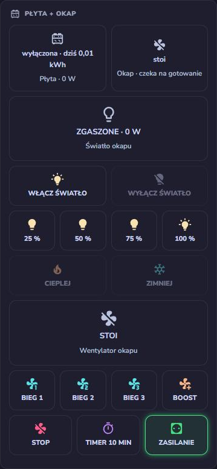
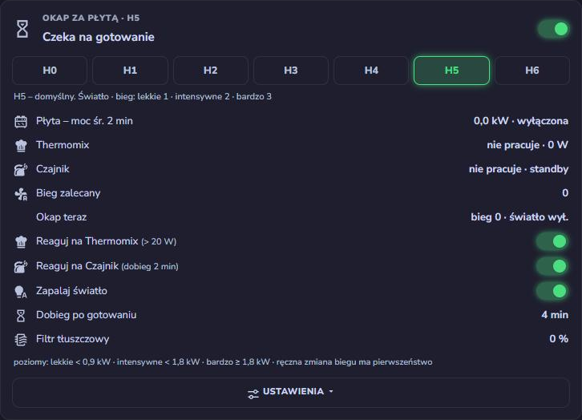
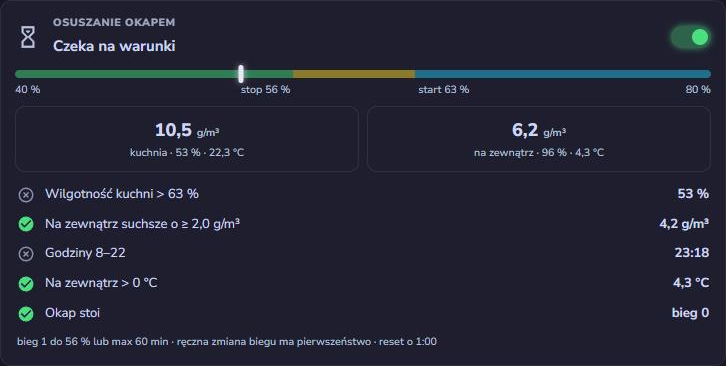

# HbH – Hob bridge Hood

[English](README.md) · **Polski**

[](https://github.com/jotuera/hbh-hob-bridge-hood/actions/workflows/ci.yml)

[](https://esphome.io)
[](https://docs.m5stack.com/en/core/ATOM%20Lite)
[](LICENSE)
[](https://buymeacoffee.com/jotuera)

**Twoja płyta indukcyjna steruje okapem – przez ESPHome, dla okapów z prostym pilotem 433 MHz.** Okap w Home
Assistant i okap, który sam idzie za płytą indukcyjną. Jeden ESP32 nadaje kody pilota i jest mózgiem okapu: zna bieg, światło i jasność z poboru mocy okapu, zapala światło po włączeniu płyty,
dobiera bieg do mocy płyty, robi dobieg po gotowaniu, osusza kuchnię okapem, a rano ustawia światło zimne, wieczorem
ciepłe. Lokalnie, bez chmury, bez automatyzacji w YAML – wszystkie ustawienia to encje urządzenia.

> Zbudowane i przetestowane na okapie **Ciarko Duo 74** z płytą **AEG IKK86688IB**. Inne okapy Ciarko z pilotem tej
> samej rodziny (np. SU Mini z pilotem XY8011-RF) mają te same kody klawiszy – ID swojego pilota nauczysz odbiornikiem
> i `tools/learn_codes.py`.
>
> **Status: beta.** Działa w kuchni autora: nadajnik, stan okapu, bieg / światło / jasność / barwa, karty, automatyka
> płyty i kalibracja są przetestowane na okapie. Automatyka płyty, osuszanie i reset nocny zostały przeniesione do ESP
> z automatyzacji Home Assistant używanych od października 2026 – wersje w ESP działają od listopada 2026. Na razie
> jeden profil (Ciarko XY8011-RF).

| Element | Co robi | Co dostajesz w Home Assistant |
|---|---|---|
| **ESP okapu** – Atom Lite + Unit RF433T (`hbh.yaml`) | nadaje ramki pilota dokładnie na 433,92 MHz z bitem przełączającym jak pilot i jest mózgiem okapu | bieg, światło (wył. / 25–100 %), barwa, timer; stan okapu; automatyka płyta → okap; osuszanie; ustawienia |
| **Odbiornik** (opcja) – Atom Lite + Unit RF433R (`hbh-remote-rx.yaml`) | dekoduje oryginalny pilot, mierzy długość trzymania | mózg i karty wiedzą, że ktoś użył pilota; zdarzenie `esphome.hbh_remote` |
| **Shelly Plus 1PM** w zasilaniu okapu | pomiar mocy i twarde wyłączenie | z niego liczony jest stan okapu (bieg, światło, jasność) |
| **Shelly Pro 3EM** / Pro EM-50 / EM Gen3 na płycie (opcja) | moc płyty, 1–3 fazy | płyta włączona, gotowanie, średnia 2 min, alarm |
| **Karty** (`cards/hbh-cards.js`) | trzy karty Lovelace, bez innych kart | sterowanie, automatyka płyty z profilami H0–H6, osuszanie |

<table>
<tr>
<td rowspan="2" valign="top"></td>
<td valign="top"></td>
</tr>
<tr>
<td valign="top"></td>
</tr>
</table>

<sub>Trzy karty w kuchni autora: sterowanie (kafel płyty z dzisiejszą energią, stan okapu z poboru mocy), automatyka płyta → okap z profilami H0–H6, osuszanie według wilgotności bezwzględnej.</sub>

## Profile okapów

Wszystko, co zależy od okapu, jest w jednym pliku w `esphome/profiles/`: ramka radiowa (czasy bitów, długość ramki,
bit przełączający), kody przycisków pilota i tabela mocy okapu. Dołącz jeden profil do packages obu urządzeń.

| Profil | Okapy | Status |
|---|---|---|
| `ciarko_xy8011.yaml` | Ciarko z pilotem z rodziny XY8011-RF – Duo 74 (przetestowany), SU Mini (te same kody klawiszy) | przetestowany |

**Inny okap?** Jeśli pilot nadaje zwykłe ramki OOK (większość pilotów okapów; kody kroczące nie zadziałają), skopiuj
profil, naucz przyciski odbiornikiem i `tools/learn_codes.py` i zmierz tabelę mocy. Otwórz zgłoszenie *Nowy profil
okapu* z plikiem – każdy profil to kolejne kuchnie, w których HbH działa. Piloty z innym układem przycisków
(bezpośrednie biegi, osobne wł./wył. światła), piloty IR i inne częstotliwości (CC1101) są w planach.

## Jakie Shelly użyć

**Okap** – Shelly z pomiarem mocy w zasilaniu okapu. Z niego liczony jest stan okapu, więc musi dobrze mierzyć małe moce
(czuwanie 0,5 W, kroki światła ~3 W): **Shelly 1PM Gen3**, **Shelly 1PM Mini Gen3** albo **Shelly Plus 1PM**
(przetestowany). Gdy okap jest wpięty do gniazdka, zadziała też Shelly Plus Plug S.

**Płyta** – licznik energii na szynę DIN z cęgami prądowymi w obwodzie płyty. Płyta pobiera do 7,4 kW (32 A na jednej
fazie), znacznie więcej niż wytrzyma wtyczka czy 1PM (16 A) – **nie** puszczaj płyty przez przekaźnik.

| Podłączenie płyty | Licznik | Źródła w urządzeniu |
|---|---|---|
| 3 fazy (większość płyt w PL) | **Shelly Pro 3EM** (przetestowany) albo Shelly 3EM Gen3 | moc płyty = łączna moc czynna; płyta ON = łączna moc pozorna (VA) |
| 2 fazy (2 × 16 A) | **Shelly Pro EM-50** (2 kanały, cęgi 50 A) – kanał na fazę | `sensor.kanal_1_moc+sensor.kanal_2_moc`, tak samo moc pozorna |
| 1 faza (32 A) | **Shelly EM Gen3** albo **Shelly Pro EM-50** (jeden kanał) | moc kanału; moc pozorna kanału (albo prąd w A) |

**Płyta na 1, 2 albo 3 fazach.** Mózg korzysta z mocy łącznej, więc liczba faz nie ma znaczenia: podaj jedną encję
łączną albo fazy zsumowane plusem (`sensor.l1_moc+sensor.l2_moc+sensor.l3_moc`). Tak samo moc pozorna. **Próg
włączenia płyty:** płyta włączona przyciskiem ON bez grzania zasila elektronikę – trójfazowy AEG autora pokazuje wtedy
≈ 380 VA zamiast ≈ 23 VA; domyślny próg to 150 VA. Płyta jednofazowa pokaże mniej: włącz ją przyciskiem ON, odczytaj
moc pozorną (albo prąd) i ustaw próg na mniej więcej połowę tej wartości. Bez źródła mocy pozornej światło reaguje tylko
na gotowanie (nie na przycisk ON).

## Dlaczego nie Broadlink?

Pierwsza wersja działała na Broadlinku RM4 Pro – co drugi, trzeci raz. RTL-SDR pokazał dlaczego: pilot nadaje na
**~433,93 MHz**, Broadlink na **~433,795 MHz**, na skraju pasma odbiornika okapu. RF433T ma stały kwarc 433,92 MHz:
**28 z 28** kodów doszło, z piwnicy i z innego piętra. Drugi powód „klikania dwa razy”: pilot przy każdym naciśnięciu
zmienia **bit przełączający**, a okap ignoruje naciśnięcie z tym samym bitem co poprzednie (bierze je za dalsze
trzymanie). Nadajnik z tego repo przełącza go jak pilot.

## Sprzęt

| Element | Uwagi |
|---|---|
| M5Stack **Atom Lite** (ESP32-PICO) + **Unit RF433T** | kabel Grove – dane na **G26** |
| M5Stack **Atom Lite** + **Unit RF433R** (opcja) | kabel Grove – dane na **G32** (druga żyła Grove!) |
| **Shelly Plus 1PM** | w zasilaniu okapu; jego pomiar mocy to czujnik stanu okapu |
| **Shelly Pro 3EM** / Pro EM-50 / EM Gen3 (opcja) | w obwodzie płyty, zobacz [Jakie Shelly użyć](#jakie-shelly-użyć) |

Bez lutowania. Nadajnik kilka metrów od okapu – nie w metalowej szafce.

## Instalacja

### 1. ESPHome

> **Kolejność:** najpierw odbiornik (z przykładowymi kodami), nagraj kody swojego pilota (krok 1b),
> potem oba urządzenia z Twoimi kodami.

Skopiuj folder `esphome/` z repo do folderu ESPHome jako `hbh/`, dopisz klucze z `secrets.yaml.example` do swojego
`secrets.yaml` i utwórz plik urządzenia:

```yaml
# hbh-hood.yaml w folderze ESPHome
substitutions:
  name: hbh-hood
  friendly_name: HbH Hood
  # opcjonalne domyślne źródła – można je ustawić później w edytorze karty
  src_hood_power: sensor.okap_moc
  src_hood_switch: switch.okap
  # kody TWOJEGO pilota (krok 1b) – profil ma tylko przykładowe
  # key_light: "…"
  # key_fan_minus: "…"   …

packages:
  profile: !include hbh/profiles/ciarko_xy8011.yaml   # Twój okap
  lang: !include hbh/lang/hbh_pl.yaml     # nazwy encji: hbh_en / cs / de / es / fr / hu / it / nl / pl / pt / sk
  hood: !include hbh/hbh.yaml

wifi:
  manual_ip:              # zalecane, gdy HA jest w innym VLAN-ie – mDNS nie przechodzi między VLAN-ami
    static_ip: 192.168.1.78
    gateway: 192.168.1.1
    subnet: 255.255.255.0
```

Odbiornik:

```yaml
# hbh-remote-rx.yaml w folderze ESPHome
substitutions:
  name: hbh-remote-rx
  friendly_name: HbH Remote RX
  # te same linie key_* co w hbh-hood.yaml

packages:
  profile: !include hbh/profiles/ciarko_xy8011.yaml
  lang: !include hbh/lang/remote_rx_pl.yaml
  rx: !include hbh/hbh-remote-rx.yaml
```

Zbuduj je w panelu ESPHome (dodatek Home Assistant) albo poleceniem `esphome`. Pierwsza instalacja przez USB (panel →
*Install* → *Manual download*, potem wgraj plik przez [web.esphome.io](https://web.esphome.io)), kolejne przez Wi-Fi.


### 1b. Kody Twojego pilota

Kody w `esphome/profiles/ciarko_xy8011.yaml` są **przykładowe** (zmyślone ID pilota) – okap na nie nie zareaguje. Każdy pilot ma własne 16-bitowe ID i zależny od niego bajt
kontrolny, więc kodów nie da się wyliczyć – trzeba je nagrać:

```bash
esphome logs hbh-remote-rx.yaml | python3 tools/learn_codes.py -o my_remote.yaml
# naciśnij: światło, bieg −, bieg +, timer, klawisz 4 (jaśniej), klawisz 5 (ciemniej) – potem Ctrl+C
```

Odbiornik loguje ramki nieznanego pilota jako `unknown frame: <bity>`; narzędzie grupuje je w klawisze, pomija
bit przełączający i wypisuje linie `key_*`. Wklej je do `substitutions:` **obu** plików urządzeń (okap i odbiornik)
– nadpisują przykładowe kody profilu – i wgraj oba urządzenia ponownie. Do tego czasu okap nie reaguje na ESP, a
odbiornik zgłasza każdy klawisz jako `unknown frame`.

### 2. Home Assistant

1. Dodaj urządzenia w *Ustawienia → Urządzenia i usługi → ESPHome* (po IP, jeśli są w innym VLAN-ie).
2. Na **obu** urządzeniach: *Konfiguruj* → włącz **Zezwalaj urządzeniu na wykonywanie akcji Home Assistant**. ESP okapu
   potrzebuje tego do przełączania zasilania okapu i alarmu płyty, odbiornik – do wysyłania zdarzeń pilota.

### 3. Karty

Skopiuj `cards/hbh-cards.js` do `/config/www/` i dodaj w *Ustawienia → Dashboardy → ⋮ → Zasoby* jako
`/local/hbh-cards.js` (moduł JavaScript). Potem dodaj karty:

```yaml
type: custom:hbh-card                # sterowanie
```

```yaml
type: custom:hbh-automation-card     # okap za płytą
aux1_name: Thermomix                 # opcjonalne nazwy źródeł dodatkowych
aux2_name: Czajnik
```

```yaml
type: custom:hbh-drying-card         # osuszanie okapem
```

Karty same znajdują urządzenie i jego encje (po nazwach pierwotnych w każdym języku), więc nie trzeba podawać
identyfikatorów encji. `device:` wskazuje urządzenie, gdy jest ich więcej.

### 4. Źródła

Otwórz edytor dowolnej karty, wybierz encje Home Assistant, które zasilają mózg, i naciśnij **Zastosuj źródła
(restart urządzenia)**. Źródła zapisują się w ESP, nie w karcie. Źródłem może być też atrybut:
`climate.kuchnia:current_temperature`.

| Źródło | Potrzebne do |
|---|---|
| Moc okapu (W) | **wymagane** – stan okapu |
| Zasilanie okapu (przełącznik) | włączania z karty, parowania po zaniku prądu, resetu nocnego |
| Moc płyty (W) | gotowania, biegu z mocy płyty – jedna encja łączna albo fazy z `+` |
| Moc pozorna płyty (VA) albo prąd (A) | światła, gdy płyta jest tylko włączona przyciskiem ON – próg *Próg włączenia płyty* |
| Źródło 1, Źródło 2 | dodatkowe źródła gotowania, np. moc Thermomixa (W) albo czajnik (W lub stan `heating`) |
| Odbiornik pilota – Zdarzenie pilota | wiedzy, że ktoś użył oryginalnego pilota (ręczne przejęcie, podpowiedzi na karcie) |
| Wilgotność / temperatura kuchni, temperatura / wilgotność na zewnątrz | osuszania |

### 5. Parowanie po zaniku prądu

Okap po włączeniu zasilania przez 60 s paruje się z pierwszym pilotem, który usłyszy. Gdy zasilanie okapu jest
źródłem, ESP wysyła „bieg −” 5 s po włączeniu przekaźnika. W przeciwnym razie wyłącz i włącz okap i w ciągu minuty
naciśnij dowolny przycisk na karcie.

## Jak liczony jest stan okapu

Okap niczego nie raportuje, więc stan wynika z poboru mocy okapu. Pobór **sumuje się**:

| | Moc netto |
|---|---|
| czuwanie | 0,5 W |
| bieg 1 / 2 / 3 | 4,4 / 10,0 / 27,5 W |
| boost (4) | 100–170 W |
| światło 25 / 50 / 75 / 100 % | 3,2 / 6,3 / 8,9 / 11,9 W (barwa prawie bez wpływu) |

**Kalibracja.** Tabela pochodzi z profilu okapu; naciśnij **Kalibruj okap** (konfiguracja urządzenia albo ustawienia
karty automatyki), a ESP sam zmierzy Twój okap: przejdzie przez czuwanie, biegi 1–3, boost i cztery poziomy światła,
przy każdym kroku poczeka na stabilny pobór i weźmie medianę (~4 min, kuchnia wolna – włączenie płyty przerywa
kalibrację). Zmierzona tabela zastępuje profil, przetrwa restart i trafia do logu jako linie `pw_*` do nowego profilu;
*Przywróć tabelę mocy z profilu* wraca do profilu. Ostrzeżenie oznacza, że dwa stany pobierają prawie tyle samo i mogą
się mylić.

Wartości się pokrywają (światło 100 % ≈ bieg 1 + światło 50 %), więc mózg śledzi **przejścia**: z ostatniego stanu
wybiera najtańszą zmianę, która tłumaczy nowy pobór; ostatnia komenda (własny nadajnik albo oryginalny pilot) to
miękka podpowiedź. Skoki przy rozruchu silnika są ignorowane, co minutę samonaprawa poprawia zły stan, a po zapaleniu
światła jasność jest brana z poboru (okap wraca do ostatniej jasności). Na biegu 3 i boost światła nie da się zmierzyć
– tam idzie za komendami. Każda zmiana z karty jest sprawdzana poborem i poprawiana, gdy naciśnięcie zginęło
(*Okap nie reaguje*, gdy dalej się nie udaje).

## Płyta → okap

| | Domyślnie |
|---|---|
| płyta **włączona** przyciskiem ON (moc pozorna powyżej *Próg włączenia płyty*) | światło (przy ostatniej jasności) |
| gotowanie (> 60 W albo średnia 2 min > 30 W) | bieg z tabeli profilu |
| poziomy mocy | lekkie < 900 W ≤ intensywne < 1800 W ≤ bardzo intensywne (histereza 20 % w dół) |
| dobieg | bieg 1 przez 4 min, potem stop i zgaszenie światła zapalonego przez automatykę (po samym źródle 2 – 2 min) |
| płyta wyłączona bez gotowania | zgaszenie światła po 2 min (jeśli zapaliła je automatyka) |
| ręczna zmiana w trakcie gotowania (karta, pilot albo bieg inny niż plan) | automatyka nie rusza wentylatora do końca sesji |
| barwa | zimna od 6:00, ciepła od 17:00 (po zapaleniu światła i o tych godzinach) |
| alarm płyty | grzanie > 120 min albo nikogo nie ma w domu (`zone.home` = 0), gdy płyta grzeje |

Profile – **H** jak *hob* (płyta): im wyższy profil, tym mocniej okap pracuje dla płyty. Bieg dla gotowania
lekkiego / intensywnego / bardzo intensywnego:

| H0 | H1 | H2 | H3 | H4 | H5 (domyślny) | H6 |
|---|---|---|---|---|---|---|
| wył. | tylko światło | 1 1 1 | 0 1 1 | 1 1 2 | 1 2 3 | 2 3 3 |

Płyta AEG / Electrolux z Hob²Hood? HbH działa w podobnym duchu, ale niezależnie – na podstawie mocy płyty mierzonej
przez Shelly, z każdą płytą i każdym okapem z obsługiwanym pilotem. HbH nie jest związany z Electroluxem; Hob²Hood
to znak towarowy Electrolux.

## Osuszanie i reset nocny

**Osuszanie** (domyślnie wyłączone): gdy wilgotność w kuchni przekracza 63 %, a powietrze na zewnątrz jest suchsze
o co najmniej 2 g/m³ wilgotności bezwzględnej, w godzinach 8:00–22:00, przy temperaturze na zewnątrz powyżej 0 °C i
stojącym okapie, wentylator pracuje na biegu 1 do spadku wilgotności do 56 % albo najwyżej 60 min. Sprawdzane co
15 min i po 10 min powyżej progu startu. Ręczna zmiana biegu je kończy; gotowanie przejmuje okap.

**Reset nocny** (domyślnie wyłączony): o 1:00, gdy okap coś pobiera, zasilanie okapu jest odcinane na 15 s – wentylator
i światło na pewno gasną, bez RF.

Wszystkie wartości to encje konfiguracyjne urządzenia i są widoczne na kartach.

## Encje, zdarzenia i akcje

- **Sterowanie:** selecty *Bieg okapu* (0–3, Boost), *Światło okapu* (Wył., 25–100 %), *Barwa światła*; przyciski
  *Światło: włącz / wyłącz*, *Timer 10 min*; bezpośrednie klawisze pilota do własnych automatyzacji.
- **Stan:** *Bieg*, *Światło*, *Jasność*, *Tryb*, *Bieg zalecany*, *Płyta włączona*, *Gotowanie*, *Moc płyty – średnia
  2 min*, *Timer – pozostało*, *Osuszanie*, wilgotność bezwzględna w kuchni i na zewnątrz, cele zmiany w toku.
- **Zdarzenia:** `esphome.hbh_alarm` `{kind: nobody_home | too_long | end, message, power_w, minutes}` – do
  powiadomień na telefon; `esphome.hbh_remote` `{key, frames, held_ms}` z odbiornika.
- **Akcja:** `esphome.<urządzenie>_send` `{key: light | fan_minus | fan_plus | timer | brighter | dimmer, frames}` – dowolny
  klawisz, 8 ramek ≈ krótkie naciśnięcie, 140 ≈ trzymanie 6 s.

## Języki

11 języków: angielski, czeski, niemiecki, hiszpański, francuski, węgierski, włoski, niderlandzki, polski, portugalski,
słowacki.

Nazwy encji pochodzą z dołączonego pliku językowego: `lang/hbh_xx.yaml` i `lang/remote_rx_xx.yaml`
(xx = en, cs, de, es, fr, hu, it, nl, pl, pt, sk). Zmiana języka zmienia nazwy encji – HA tworzy nowe, historia zostaje
przy starych. Karty mówią w języku Home Assistant i rozpoznają nazwy encji w każdym języku. Nowy język: przetłumacz
`esphome/lang/hbh_en.yaml`, `remote_rx_en.yaml` i `cards/i18n/en.json`, potem uruchom `python3 tools/gen_card_names.py`
– sprawdzi pliki (brakujące klucze, znaczniki, powtórzone nazwy) i zbuduje tabele kart.

## Kontrola

Każdy push sprawdza [CI](.github/workflows/ci.yml): pliki językowe i teksty kart są kompletne, a tabele kart aktualne
(`tools/gen_card_names.py --check`), oba urządzenia przechodzą `esphome config` we wszystkich 11 językach i kompilują
się na wersji ESPHome, na której działają urządzenia autora. To samo lokalnie:

```bash
python3 tools/gen_card_names.py --check
python3 tools/ci_configs.py              # pliki urządzeń dla każdego języka w build/ci/
esphome config build/ci/hood_de.yaml
```

Zgłoszenia mają formularze: *New hood profile* (plik profilu, tabela z kalibracji, co działa), *Bug report*,
*Question or idea* – można pisać po polsku.

## Zmiany

Zobacz [CHANGELOG.md](CHANGELOG.md).

## Protokół

[docs/profiles/ciarko_xy8011.md](docs/profiles/ciarko_xy8011.md) (po angielsku): OOK/PWM, ramka 36 bitów (16 bit ID pilota + 8 bit klawisz + 8 bit
kontrolny + bit przełączający + `010`), czasy, kody klawiszy, co robi przytrzymanie.

## Znane ograniczenia

- Na biegu 3 i boost światła nie da się zmierzyć (silnik pobiera znacznie więcej) – zmiany jasności idą tam tylko za
  naciśnięciami i nie są sprawdzane.
- Tabela mocy profilu pochodzi z Ciarko Duo 74 – przy innym okapie naciśnij raz *Kalibruj okap*.
- Tylko piloty ze stałymi (nie kroczącymi) kodami i układem klawiszy światło / bieg − / bieg + / timer / jaśniej / ciemniej.
- Przetestowane w jednej kuchni. Automatyka płyty, osuszanie i reset nocny są nowe w ESP – zgłaszaj, co zauważysz.
- Tłumaczenia poza angielskim i polskim powstały z pomocą AI – poprawki od native speakerów mile widziane.

## Plany

- Więcej profili okapów – inne układy klawiszy, piloty IR, inne częstotliwości (CC1101).
- Jeden Atom z oboma modułami (hub Grove: RF433T na G26, RF433R na G32) i tłumienie echa w ESP.
- HACS dla kart.

## Wsparcie

Jeśli ten projekt Ci się przydał, możesz postawić mi kawę. Dziękuję!

<a href="https://buymeacoffee.com/jotuera"></a>

## Licencja

[PolyForm Noncommercial 1.0.0](LICENSE): bezpłatnie do użytku prywatnego i innego niekomercyjnego. **Użycie
komercyjne** (instalatorzy montujący u klientów, sprzedaż urządzeń z tym firmware) wymaga osobnej licencji – skontaktuj
się przez GitHub. Zobacz też [NOTICE](NOTICE). Ciarko, AEG, Electrolux, Hob²Hood, Shelly i M5Stack to znaki towarowe ich właścicieli.
